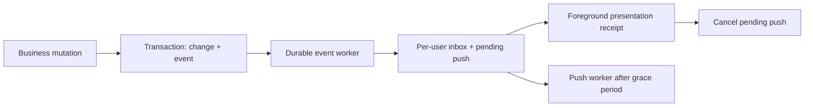

# Notifications module plan

Status: implemented in the working tree on 2026-11-03. The additive migration was verified on a disposable PostgreSQL database; the application/production database was not changed. Deployment configuration and real-provider push verification are described in [notifications.md](../notifications.md). Native mobile integration and rental/client email remain future work as agreed.

## Confirmed product decisions

- Admins receive notifications about meaningful business changes across the application, subject to their current permissions.
- Mechanics receive notifications about assignments and changes to their assigned scooter issues, including comments.
- TODOs remain admin-only. This module does not change assignment eligibility or business access.
- While using the app, recipients see in-app notifications. When away, they receive push notifications if they have an enabled, supported subscription.
- Notifications always remain available in a persistent inbox, regardless of delivery channel.
- Staff do not receive notifications about actions they performed themselves. Their actions remain in activity history.
- Email is a supported future delivery channel, intended for rental-specific client notifications. Email triggers are undecided; the initial staff release sends no notification emails and does not use email as an automatic push fallback.
- Native mobile push is a later client integration: the current native app still lacks authentication and the API client. The first release provides browser/PWA push, including supported mobile browsers and installed web apps.

## Scope and event vocabulary

Interpret CRUD notification requirements as successful create, update, archive, and delete operations. Reads, previews, failed requests, no-op saves, and technical retries are not business notifications. Existing access/security auditing remains separate.

| Domain                 | Events to cover                                                                                                                                                 |
| ---------------------- | --------------------------------------------------------------------------------------------------------------------------------------------------------------- |
| Scooters               | Creation, material edits, archive/deletion, photos and documents added/changed/removed, relevant document visibility changes                                    |
| Rentals                | Creation/reservation, handover, return, cancellation, saved business changes, inspection completion/confirmation, payment confirmation                          |
| Persons                | Creation, edits, archive/deletion, identity document creation/update/replacement/removal                                                                        |
| Users/access           | Role assignment/removal, individual permission changes, access status changes, shared role definition changes                                                   |
| Issues/TODOs           | Creation, edits, assignment/reassignment, claim, work started/paused, resolution, reopening, cancellation, priority/difficulty/hold changes                     |
| Issue/TODO content     | Comments, checklist and buylist addition/edit/removal, item completion, section changes, location addition/change/removal, photos                               |
| Expenses               | Expense posted, reversed, and supported receipt/document changes; use the actual finance lifecycle rather than inventing update/delete actions                  |
| Brands                 | Creation, edits, deletion                                                                                                                                       |
| Other business modules | Inventory and cover successful mutations in locations, suppliers, financial reference data, contracts, and other existing modules using the same event contract |

“Scooter rented” means handover. Rental creation is a separate reservation/setup event. Issues and TODOs currently support cancellation, not deletion; this module reports that lifecycle without adding destructive operations.

Use typed, versioned semantic event keys. A combined save produces one notification describing the meaningful changes, such as “Maria changed the checklist and location.” Resolution notes remain part of the resolution event rather than generating a duplicate comment alert. A command that legitimately changes multiple business records can produce correlated events; the UI may group them without discarding their history.

Event coverage must be an explicit inventory of business mutation entry points. Do not infer events from a generic HTTP interceptor, arbitrary database writes, or raw request payloads.

## Existing implementation and integration points

- [AuditService](../../apps/api/src/audit/audit.service.ts) has best-effort `record()` and transactional `recordRequired()`. Best-effort auditing cannot be the sole source of durable notifications.
- [Scooter creation/update](../../apps/api/src/scooters/scooters.service.ts) already use transactions and actor IDs, but lack CRUD events. Deletion also needs actor context and a transaction. Document editor replay paths must return without publishing another event.
- [Brands](../../apps/api/src/scooter-brands/scooter-brands.service.ts) need actor context and transactional event writes, including a safe snapshot before deletion.
- [Persons](../../apps/api/src/persons/persons.service.ts), [rentals](../../apps/api/src/rentals/rentals.service.ts), and [access management](../../apps/api/src/access/access.service.ts) already write required audit records inside business transactions. Add notification events at those same semantic boundaries.
- [ProblemsService](../../apps/api/src/problems/problems.service.ts) centralizes most issue/TODO mutations and records before/after audit snapshots. Photos need explicit change metadata because photo-only changes are not represented by those snapshots. Comments are stored as audit events and need assignment context captured at creation time.
- [Finance repository](../../apps/api/src/finance/infrastructure/prisma-finance.repository.ts) contains transactional expense posting and reversal boundaries. Legacy finance audit constants do not establish event coverage in the current implementation.
- [Document dispatch](../../apps/api/src/scooter-document-jobs/scooter-document-dispatcher.service.ts) provides a precedent for database-backed work, leases, conditional claims, and retries. Reuse the pattern through notification-specific services.
- [WorkspaceNotifications](../../apps/web/src/components/WorkspaceNotifications.tsx) currently provides temporary form toasts. Persistent activity notifications need a distinct inbox and lifecycle.
- [Mobile README](../../apps/mobile/README.md) documents missing native authentication, SecureStore, Bearer adapter, and refresh handling.

## Persistence and processing

The business change and its event commit or roll back together. Notification presentation and external delivery happen afterward. If durable event persistence fails, the mutation must not report success without its event. An unavailable push provider does not roll back a completed business action.

Proposed persisted concepts, with final schema names chosen during implementation:

| Concept                  | Responsibility                                                                                                                                                                                                                                      |
| ------------------------ | --------------------------------------------------------------------------------------------------------------------------------------------------------------------------------------------------------------------------------------------------- |
| Business event/outbox    | Stable event ID, event type/version, actor or system identity, subject and parent references, occurrence time, command/revision correlation, safe display snapshot, changed fields, event-time audience context, dispatch lease/attempt/retry state |
| Recipient notification   | Event ID, recipient ID, routing reason, creation time, presentation time, explicit read time; unique event/recipient pair                                                                                                                           |
| Notification preferences | Per-user supported channel/category choices; defaults implement the confirmed admin/mechanic behavior                                                                                                                                               |
| Delivery attempt         | Notification, channel, destination, pending/claimed/accepted/failed/cancelled state, deadline, retry/lease metadata and diagnostic information                                                                                                      |
| Push subscription        | Authenticated user/session ownership, browser endpoint/key material, device/install identity, locale and lifecycle state                                                                                                                            |

Keep immutable business event content distinct from mutable processing state, even if the initial outbox uses one physical table. Keep notification retention independent of existing audit retention. Select retention periods before rollout; do not delete audit history as part of notification cleanup.

Use Postgres-backed dispatch initially. No new Redis/message-broker dependency is required. Workers must be safe across multiple API instances, reclaim abandoned leases, use bounded retries/backoff, and expose permanently failed work for inspection and deliberate replay.

Deduplicate recipient notifications by event and recipient, and delivery work by notification/channel/destination. Respect existing domain idempotency keys and revision checks when publishing events. Inbox deduplication does not turn a non-idempotent business command into an idempotent one.

## Recipient policy and access

Use the live permission system, not legacy JWT role strings or client-provided recipients. Introduce explicit notification audience capabilities with Admin defaults for business activity and Mechanic defaults for assigned issues. Apply default grants through a reviewed additive migration that preserves existing overrides and access restrictions.

For each event:

1. Capture eligible audience context within the originating transaction, including the issue's previous/new assignees and the users eligible for admin activity at that time.
2. Create notifications for the applicable audience, excluding the actor and deduplicating overlapping reasons.
3. Recheck active account status, current audience eligibility, and source-specific read access before external delivery and whenever notification content is returned.
4. Apply the same access filtering to lists, pagination and unread counts. A notification never grants access to a business record.

Mechanic assignment routing must support both existing legacy `assigneeId` and the current multiple-assignee relationship through the shared assignment helpers:

- Newly assigned mechanics receive an assignment notification, including assignment during creation, editing, explicit assignment, and self-claim (subject to actor suppression).
- Retained assignees receive subsequent meaningful changes/comments.
- Removed assignees may receive a minimal “A job was removed from your assignments” notice. This narrow policy permits no confidential task details or working deep link after access has ended.
- A delayed comment event retains its original assignment context. A mechanic added later does not receive that earlier comment; one who has since lost access does not receive its details.
- Mechanics receive no general TODO activity and no complete raw audit payloads.

For archived/deleted subjects, keep only the minimal authorized display snapshot and render an unavailable target state rather than a broken link. Revoked domain access still hides protected historical content. Access and role-definition events require their corresponding user/role inspection authority.

## In-app delivery and push fallback

The initial foreground transport can be authenticated polling while the app is visible and focused, with refresh on focus/reconnection and backoff after errors. Keep it independent of push. Polling must retrieve pending in-app alerts, not just an unread count. Tune its interval and the fallback grace together; proposed initial values are a five-second foreground poll and fifteen-second push grace, subject to implementation validation.

Delivery policy is user-wide across devices:

1. Persist the inbox notification and pending push fallback together.
2. A visible, focused app renders the specific in-app alert and sends an authenticated, idempotent presentation receipt for it.
3. A presentation receipt from any device cancels still-pending push for that notification across the user's devices.
4. Without a receipt before the grace deadline, send to the user's eligible push subscriptions. An open connection, recent heartbeat, background fetch, or badge update never suppresses push on its own.
5. Recheck read state, presentation cancellation, permissions, account status and subscription ownership immediately before claiming/sending.
6. Use stable notification IDs/tags to reduce duplicates. A receipt racing an already-dispatched push can still produce both alerts; preserve the durable inbox and accept this bounded race.

Receiving, presenting, and reading are different states. Rendering a banner or a provider accepting push must not mark the notification read. Clicking a notification or using an explicit read action updates shared read state. A notification read on another device before fallback is dispatched cancels that pending fallback.

Push is an attention channel, not proof that a user received or read the message. If permission is denied, unsupported, disabled, or a subscription expires, retain the inbox notification and show an accurate settings status. Do not silently substitute email.

The server makes the foreground suppression decision before sending Web Push. Every actual Web Push must have visible notification content; do not send a push and then silently suppress it in a service worker when a tab is focused. WebKit explicitly disallows silent pushes and documents subscription revocation for this behavior. See [WebKit's push explanation](https://webkit.org/blog/16535/meet-declarative-web-push/).

Use standard browser/PWA push with service-worker handling for cross-browser support. Ask permission through an explicit user action. On iPhone/iPad, provide the appropriate Home Screen installation guidance; Apple documents Web Push for Home Screen web apps on iOS/iPadOS 16.4 and later in its [Web Push requirements](https://developer.apple.com/documentation/usernotifications/sending-web-push-notifications-in-web-apps-and-browsers).

Tie destinations to authenticated account/session ownership and detach them on logout, revoked sessions, and account switching. Push payloads contain a minimal safe summary and notification ID; detailed data is fetched after normal authentication/authorization. Already dispatched messages cannot be recalled by revoking later access.

## API, shared contracts, and web surfaces

- Add a NestJS notifications module and typed `v1.notifications` contracts in `@repo/api-shared`, with the existing Zod DTO/serialization/OpenAPI conventions.
- Provide inbox listing with cursor/category/unread filters, unread count, mark one read, mark all read up to a reviewed cutoff, presentation receipts, channel preferences, and push subscription registration/removal.
- Derive the recipient from authentication for every own-inbox operation; never accept arbitrary recipient IDs from the client.
- Add an authorized admin activity-history view backed by business events, including the actor's own actions. It must filter source access before counts/pagination.
- Use existing custom authentication and `apiFetch`; cookie-bearing mutations retain the shared CSRF header behavior.
- Add a global bell/recent-alert integration to AppShell and a locale-aware full notifications page. Synchronize read state across tabs/devices.
- Reuse `@repo/ui` Button, Badge, Popover, BottomSheet and PageLayout, their existing stories, shared forms, and theme tokens. Preserve `bg-popover` throughout any mobile sheet and test its surface.
- Use shared SaveButton/FormActions for notification preference forms. Feature-specific inbox components live under the notifications route's private folders; app-wide delivery/bell integration can live in shared app components.
- Store typed message keys and safe interpolation data rather than permanent English sentences. Add English/Romanian catalogs to `@repo/i18n`.
- Include `brandCode` in scooter summaries and display scooter identifiers through `v1.scooters.scooterDisplayCode(scooter)`.
- Treat pushed text as an immutable localized delivery snapshot; fetching the inbox can use the recipient's current locale.

## Future rental/client email

Keep the delivery boundary channel-independent and reuse the existing [MailerService](../../apps/api/src/mailer/mailer.service.ts) when email workflows are defined. No new mail provider is needed for this plan.

Future product work must choose rental/client events, timing, recipient eligibility, message templates, and preferences before enabling email. Booking confirmations, handover information, payment receipts, and rental reminders are possible examples, not approved triggers.

Client transactional communications have a separate policy from staff activity alerts. Staff actor suppression must not prevent a client from receiving a future confirmation for a rental action they initiated. Scheduled reminders also require durable scheduling/cancellation against the current rental state rather than an immediate-event-only implementation.

## Implementation sequence

1. **Event foundation and coverage inventory.** Verify current Prisma 7 documentation before writing schema/client/migration code; retain the existing generated client, driver adapter and explicit pool configuration. Define typed events, audience policy, safe snapshots, additive persistence, and atomic publishing. Inventory all current business mutations and close uncovered scooter/brand/finance/location/attachment paths.
2. **Durable processing and API.** Add multi-instance-safe event dispatch, inbox/preferences/read state, the permission catalog/default migration, shared schemas, authorized activity history, and regenerated OpenAPI. Launch cutover creates no notifications for historical audits.
3. **Foreground web experience.** Build the bell, in-app alerts, full inbox, activity history, settings, localization, foreground transport, presentation receipts, and read synchronization using shared UI/theme defaults.
4. **Browser/PWA push.** Add subscriptions, permission/install guidance, service-worker display/click behavior, server-side receipt suppression, durable fallback/retries, destination cleanup, and staging configuration for push keys/origins. In-app and away delivery are both required before the first staff notification release is complete.
5. **Verification and rollout.** Rehearse additive migrations against a disposable database; deploy API/shared contracts/web compatibly, verify with real browser subscriptions in staging, then enable notifications and monitor processing lag/failures. Native push and rental/client email remain separate future integrations.

## Acceptance checks

- Every inventoried successful business mutation has the correct event; rollback, failed validation, previews, no-op saves, command replay, and technical worker retries do not create misleading/duplicate alerts.
- Admin and multiple-assignee routing works, actor notifications are suppressed, TODO access is unchanged, reassignment snapshots are correct, and source permission revocation applies to payloads, counts and delivery.
- Event workers recover from crashes and concurrent claims; retries/replay cannot duplicate inbox entries. Failed external delivery does not damage the business action or inbox.
- Focused-app presentation cancels pending push across devices. Hidden/suspended/offline tabs, stale presence, missing receipts and lost receipts still reach push fallback. Background fetches do not count as presentation.
- Read state stays separate from delivery/presentation, and read-all uses a cutoff so concurrently arriving notifications stay unread.
- Push tests cover permission denial, unsupported browsers, expired subscriptions, retryable provider failures, account switching, logout/revocation, click navigation, and the dispatch/receipt race.
- Deletion/archival yields safe unavailable targets; personal document and access audit metadata never leaks through feeds or push.
- English/Romanian messages, brand-qualified scooter codes, keyboard/accessibility behavior, responsive inbox surfaces and bottom-sheet surface protection are verified.
- API contract/authorization tests, focused UI/worker tests, current type/lint checks, and staging browser/PWA smoke checks pass. Native push is tested only when its authenticated client integration exists.
- Notification email delivery remains disabled until rental/client triggers and templates are explicitly specified.

## Documentation verification

The installed Prisma and `@prisma/client` versions are 7.8.0. Implementation was checked against the Prisma ORM v7 documentation on 2026-11-03, including [transactions](https://www.prisma.io/docs/orm/v7/prisma-client/queries/transactions), [generators](https://www.prisma.io/docs/orm/v7/prisma-schema/overview/generators), [configuration](https://www.prisma.io/docs/orm/v7/reference/prisma-config-reference), [pooling](https://www.prisma.io/docs/orm/v7/prisma-client/setup-and-configuration/databases-connections/connection-pool), and the [CLI](https://www.prisma.io/docs/orm/v7/reference/prisma-cli-reference). The existing generated-client path, adapter, environment loading, TLS and explicit pool configuration are preserved. Real PostgreSQL regressions cover the transaction client behavior rather than inferring it from proxy membership or method presence.
